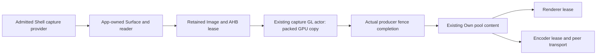

# Packed wide input: consumer seams

This guide describes a frozen producer/consumer alignment, not an implemented
capture provider or production adoption. The coherent platform-provider source
revision is still pending. Existing public sink primitives are pinned at Lab
`97d7152f2624a29e5b00a5b9c24d3d3b4ccdb281`; their exact eight-file
[inventory](../../adapters/capture-bridge/controller/SINK-DEPENDENCY.json)
retains sink source `fa68038e75e7175511f9a9f68c041cb321e7fa5e`.
The executable identity example remains a reader-absent host fixture.

## Selected path and ownership

Each endpoint owns its input queue. A diagnostic Surface is an input endpoint,
not a completed-frame export that another app can consume. The selected path
uses an instance-owned Java ImageReader and Image/HardwareBuffer leases on the
existing capture GL actor; a
SurfaceTexture/OES substitute is outside this alignment. The copy is already
packed stereo, with no CPU pixel readback, second eye pairer or new effect.

The platform owns reader creation, callback/acquisition gates, retained image
leases and the fixed snapshot compatibility adapter. The carrier owns source
choice, GL import/copy, pool/renderer/encoder lifetime, peer metadata and XR
submission. Lab supplies existing local accounting and neutral documentation.
The actual runtime owner supplies the admitted Shell provider and original
Start/Stop/process/pipe custody. Device-local pixels and headset-to-headset
transport do not remove the current ADB/bootstrap/control dependency.

## Keep the interfaces distinct

The initial compatibility adapter preserves the app-owned
`NativeMetaInputPublisher.v2` snapshot wire: synchronous requests, exact positive
reader generation, configured descriptor and an owned Surface wrapper. Discovery
with a wildcard generation is not admission. The service cannot adopt a
replacement reader. Retained status must come from actual same-generation
copy/pool completion, not a synthesized heartbeat. Diagnostic mode switching is
not a production effect-control interface.

Lab's [19-word sink ABI](../../adapters/capture-bridge/CONTRACT.md) is a separate
wire. Reusing `SinkPublisherOwner` or `SinkAdmission` accounting does not make
that ABI compatible with deployed v2. An explicit adapter preserves the chosen
wire and actual caller checks; possessing a descriptor or nonce grants no Shell
privilege or capture authority. Ordinary app-owned reader publication and the
privileged capture controller remain separate responsibilities.

## Retained acquisition and the copy fence

1. Construct a real reader with typed process/reader generations and validated
   format, usage, dimensions and capacity. Obtain a separately owned Surface
   wrapper for that exact reader, retaining the app's original wrapper. Recheck
   generation/admission after wrapper acquisition.
2. Register actual callback/acquisition entry. A short callback signals the
   owned worker; GL work stays on the capture GL actor. The latest slot may
   replace only an unsubmitted acquisition, releasing it outside shared locks.
3. The owned acquisition token retains both the original acquired Image and an
   independently retained AHB. Keeping only the AHB does not prevent reuse of
   its queue buffer. Tokens are registry identities, never pointer casts. Actual
   immutable buffer descriptors and exact generation accompany every lease.
4. The selected Java path has its own Android 14 AOSP source evidence: acquisition
   calls `acquireBuffer(buffer, 0)` with the default `waitForFence=true`, which
   waits for a valid producer fence before returning. This supports the selected
   synchronous-acquisition policy without borrowing the earlier NDK proof.
   A blocked acquire retains its original worker/custody; a timeout is not
   completion. No separate acquisition FD is supplied by this route, and absence
   is not a fabricated signalled fence. See the evidence scope below.
5. On the existing capture GL actor, borrow the AHB only while its token is held,
   validate actual format/size/usage/stride and supported import capabilities,
   and copy into an existing pool Write target. Register the source GPU hold
   before possible submission. Keep the source token/import and pool ticket
   joined to the original pending copy.
6. Only actual copy producer-fence completion permits pool publication and source
   image release. Destroy the import on its owning GL actor after it is idle.
   Unknown import, submission, fence or teardown retains/quarantines the exact
   resources; elapsed time is not completion.
7. After a completed copy the pool owns its content independently. Renderer and
   encoder leases retain their own fences; encoding need not retain the original
   source Image once the source-to-pool copy really completed.

Existing accounting calls include `beginCallback`, `imageAcquired`,
`publishCurrent`, `beginFence`, `fenceCompleted` and `imageReleased`. They record
real observations supplied by the resource owner; they do not release native
resources themselves. Publication callbacks are bounded metadata operations,
not GPU work, waits or unrelated reentrant work under the owner monitor.

## Stop, draining and source changes

Close media publication/freshness first through the provider's `stopPublishing`
gate, while retaining the original helper request, worker, image/import holds
and app resources. Cleanup draining continues while the original external Stop
is unresolved so a full queue cannot block its producer.

The selected mapping keeps `SinkPublisherOwner` ACTIVE only for counted cleanup
acquisitions during that interval, because `beginCallback` requires ACTIVE at
the pinned API. ACTIVE accounting is not media-ready authority. The provider
must guard new GPU/media/pool publication with its stopped-media state; cleanup
arrivals cannot refresh content. No fake counters, fresh reader generation or
dropped image hold is introduced. The end-to-end Stop binding still needs its
actual provider implementation/test pin.

After admitted external retirement, seal callback/acquisition entry and cross
its barrier, then structurally invalidate the accounting owner. Join original
entered work, retire actual copy/pool/encoder uses, release queued/acquired images and
actually close the reader/window/Surface. Listener removal alone is not a
callback join; retain a sealed callback tombstone if the platform supplies no
such join. A reader retained until process exit cannot report normal
`readerDestroyed`. Only actual observations drive `observeDrained` and `retire`.
Unknown cleanup remains quarantined and prevents replacement.

Initial source changes occur only from idle and fully drained state. Source
choice is independent of Own/Peer/Blend display choice; Camera2 remains the
default. Continuous-until-Stop operation requires the actual original custody
provider and its continuous policy. Repeated finite-controller invocations are
not a substitute. Accepted Stop, helper grace/death, host EOF/reap, app drain and
global quiet are separate facts; none creates a vendor retirement ACK.

## Metadata, no saving and exclusion

Consume the carrier's additive source identity contract: legacy camera pair
versus one packed wide acquisition. Keep legacy camera serializers and pairer
semantics intact. Both storage eyes refer to the same packed acquisition's
sequence/timestamp; never manufacture two sensor clocks. Producer time is in an
explicitly unverified domain, arrival monotonic time is separate freshness
evidence, and encoded PTS is a separate codec observation.

Keep capture/encoded extent, per-eye storage/coverage/orientation, projection
provenance and unknown pose/colour/clock capabilities explicit. Reader, process,
pool, route and source-instance generations are separate identities. H264's
opaque alpha does not replace geometric validity. Matched wide peers retain
independent per-endpoint calibration/provenance; mixed wide/camera compatibility
is not assumed. This guide defines no new peer format or calibration.

The actual production composition must disable every pixel file/readback-export
and recording writer, including deferred diagnostic requests, before Start.
Live GPU processing and in-memory codec transport remain permitted. A diagnostic
artifact's no-save setting is not the carrier's effective-policy proof. Bounded,
low-cadence status metadata does not impose an inspection-duration timer.

The actual XR submission owner must exclude all emitted app-owned raw,
processed, peer, UI and video layers that can feed back, while preserving the
intended native room source. Use the supported submission/layer path and its
source pin; an offscreen copy is not an XR next-chain insertion point. Selected
output/menu hooks are not whole-carrier/underlay device proof. Ordinary MR pool
handles confer neither exclusion nor access permission.

The provider implementation/pin, actual Android/Surface behavior, real resource
observations, whole-carrier exclusion, continuous Stop/custody, restart, bilateral
media and physical presentation still require their own evidence. This guide
neither transfers diagnostic acceptance nor attributes or repairs head-motion
latency. No deployment commands, vendor implementation, private effects, media
or device/profile pins are supplied here.

## Acquisition source evidence

The independent Java-path references are Android `android-14.0.0_r1`
[ImageReader acquisition](https://android.googlesource.com/platform/frameworks/base/+/android-14.0.0_r1/media/jni/android_media_ImageReader.cpp#542)
and the [BufferItemConsumer fence-wait default](https://android.googlesource.com/platform/frameworks/native/+/android-14.0.0_r1/libs/gui/include/gui/BufferItemConsumer.h#74).
Their source-byte SHA-256 pins are, respectively,
`a1fcbdd2242f40e075339380f4a0bf0d0cb79203e18e3d5948953d8f8f402de0`
and `0ad0c5e763fc443b5574c415a864c60745ed80034423cedc25448d472cee1ca1`.
No AOSP implementation text or binary is imported by this guide.

These are framework source-contract references, not proprietary headset-binary,
timing or producer-clock proof. The actual provider cohort must bind its real
acquisition semantics and retain original blocked-acquire/join custody. A future
asynchronous or FD-returning route must retain its actual FD owner and receive
separate source/runtime qualification.
